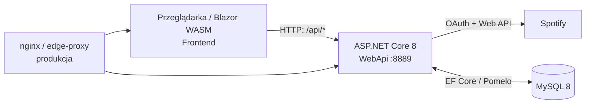

# Spotify Basic API 2025 — orientacja w projekcie

> Dokument startowy dla kolejnych zadań. Opisuje stan wynikający z kodu na dzień jego utworzenia; gdy dokumentacja historyczna różni się od implementacji, źródłem prawdy jest kod (`Program.cs`, kontrolery i serwisy).

## 1. Cel i architektura

Projekt jest menedżerem biblioteki Spotify. Użytkownik loguje się przez OAuth 2.0, aplikacja pobiera dane z Web API Spotify, zapisuje ich lokalny obraz w MySQL i udostępnia go w interfejsie Blazor WebAssembly. Lokalna warstwa biblioteki dodaje funkcje, których nie zapewnia Spotify: tagi z siłą, własne foldery playlist i zapamiętane filtry.



- **Frontend** jest aplikacją statyczną Blazor WASM (`Frontend`), a nie serwerem .NET.
- **Backend** (`WebApi`) jest jedynym komponentem komunikującym się z Spotify i bazą.
- **Baza** przechowuje zarówno znormalizowany cache/snapshot danych Spotify, jak i dane specyficzne dla użytkownika.
- W produkcji kontenery dołączają do zewnętrznej sieci Docker `edge-proxy`; reverse proxy przekazuje ruch do aliasów `spotify-frontend` i `spotify-webapi`.

## 2. Szybka mapa katalogów

| Lokalizacja | Rola |
| --- | --- |
| `Frontend/Pages` | Ekrany i ich logika wywołań HTTP. Najlepszy punkt startu dla zmian UI. |
| `Frontend/Components` | Wspólne komponenty tagowania (`TaggingPanel`, `TagSearchSelect`, `TagBadge`). |
| `Frontend/Layout` | Główny layout, nawigacja i pasek odtwarzacza. `NavMenu` buduje drzewo folderów. |
| `Frontend/wwwroot` | Statyczne zasoby, konfiguracja `ApiBase`, CSS oraz skrypty synchronizacji UI. |
| `WebApi/Controllers` | Cienka warstwa HTTP; grupowanie publicznych endpointów. |
| `WebApi/Services` | Reguły biznesowe, Spotify API, synchronizacje i dostęp do bazy. |
| `WebApi/Entities` | Encje EF Core oraz kontekst bazy. |
| `WebApi/Models` | DTO dla UI/API, modele Spotify, paginacja i rozszerzenia mapujące. |
| `WebApi/Migrations` | Migracje EF Core. Są uruchamiane automatycznie przy starcie API. |
| `Manuals` | Dokumentacja pomocnicza; ten katalog jest właściwym miejscem na notatki techniczne. |
| `docker-compose.yml`, `WebApi/Dockerfile`, `Frontend/Dockerfile` | Uruchamianie kontenerowe i deployment. |

## 3. Przepływy, które trzeba znać

### Logowanie i token

1. `Frontend/Pages/Home.razor` pobiera `GET /api/auth/login` i przekierowuje przeglądarkę na adres Spotify.
2. Spotify wraca na adres skonfigurowany w `Spotify:RedirectUri` — dla frontendu jest to `/callback` (`Frontend/Pages/Callback.razor`).
3. Strona callback odczytuje `code` i wysyła go do `POST /api/auth/exchange-code`.
4. `AuthService` wymienia kod na tokeny; `TokenManagerService` zapamiętuje je w pamięci procesu.
5. `SpotifyRequestService` używa tokenu dla żądań do Spotify, odświeża go z wyprzedzeniem 60 s, ponawia raz po `401` i obsługuje `429` z `Retry-After` (maks. 5 prób w metodzie generycznej `GetAsync`).

**Kluczowe ograniczenie:** `TokenManagerService` jest singletonem, ale token nie jest zapisany w bazie ani powiązany z sesją HTTP. Jedna instancja API efektywnie obsługuje w danym czasie jeden aktywny token Spotify; restart kontenera usuwa logowanie. Nie zakładać obsługi wielu równoległych użytkowników bez przebudowy tej części.

### Synchronizacja biblioteki

Ekran `Frontend/Pages/Sync.razor` uruchamia endpointy `POST /api/spotify/*/sync`. `SpotifyApiService` pobiera pełne, stronicowane dane Spotify i zapisuje/aktualizuje snapshot w MySQL:

- artyści obserwowani → `SpArtists` + `LibArtistUserAssign`,
- zapisane albumy → albumy, artyści, utwory i relacje + `SpSavedAlbums` + `LibAlbumUserAssign`,
- zapisane utwory → utwory, albumy, artyści i relacje + `SpSavedTracks` + `LibTrackUserAssign`,
- playlisty → playlisty, ich właściciele, utwory i `SpPlaylistTracks`.

Synchronizacje albumów, utworów i playlistów usuwają nieaktualne relacje użytkownika/snapshoty, a synchronizacja playlist może usunąć lokalne playlisty nieobecne już na Spotify. Serwis zapisuje większe zbiory partiami i czyści tracker EF w długiej synchronizacji. To są operacje zewnętrzne i potencjalnie kosztowne — nie powinny być wywoływane z renderowania komponentu ani w pętli.

### Lokalna biblioteka

`LibraryService` czyta przede wszystkim lokalną bazę i zwraca dane do list artystów, albumów, utworów i playlist. Obsługuje paginację, filtry, sortowanie i agregaty tagów. To warstwa właściwa do rozbudowy funkcji bibliotecznych, a nie `SpotifyApiService`.

Niezależne dane lokalne:

- `LibTagGroup` → grupa tagów użytkownika;
- `LibTag` → tag, z flagami określającymi typy elementów, do których pasuje;
- `LibTagAssign` → przypisanie tagu do elementu Spotify (`ItemType` + `SpotifyItemId`) i `Strength`; identyfikator elementu jest celowo "miękkim" powiązaniem, bez FK do tabel Spotify;
- `LibPlaylistFolder` → hierarchiczny folder użytkownika;
- `SpPlaylist.FolderId` / `LibPlaylistFolderAssign` → przypisanie playlisty do folderu;
- `LibSavedFilter` → pełny stan filtrów jako JSON, z zakresem `tracks`, `albums`, `artists` lub `playlist` i opcjonalnym `ContextId` playlisty.

## 4. Model danych w skrócie

```text
SpUser
 ├─ LibArtistUserAssign ─ SpArtist ─ SpTrackArtist ─ SpTrack ─ SpPlaylistTrack ─ SpPlaylist
 ├─ LibAlbumUserAssign  ─ SpAlbum  ─ SpAlbumArtistAssign ─ SpArtist
 ├─ LibTrackUserAssign  ─ SpTrack
 ├─ SpSavedAlbum        ─ SpAlbum
 ├─ SpSavedTrack        ─ SpTrack
 ├─ LibTagGroup ─ LibTag ─ LibTagAssign ──(ItemType + SpotifyItemId)
 ├─ LibPlaylistFolder (drzewo ParentId)
 └─ LibSavedFilter
```

Konfiguracja relacji, indeksów, zasad usuwania i unikalności jest w `WebApi/Entities/Context/DatabaseContext.cs`. W szczególności unikalne są m.in. pary użytkownik–element dla lokalnej biblioteki, użytkownik–tag–element dla przypisania tagu oraz użytkownik–zakres–kontekst–nazwa dla filtra.

## 5. API: gdzie szukać funkcji

Pełny kontrakt najlepiej odczytywać z kontrolera i strony, która go wywołuje. Poniższa mapa wystarcza do szybkiej orientacji.

| Obszar | Kontroler / główne endpointy | Konsumenci frontendowi |
| --- | --- | --- |
| OAuth | `AuthController`: `/api/auth/login`, `exchange-code`, `refresh[-current]`, `current-token`, `clear-token`; callback backendowy: `/callback` | `Home`, `Callback` |
| Zewnętrzne Spotify + synchronizacja | `SpotifyController`: `/api/spotify/profile`, `search`, `artists/*`, `albums/sync`, `tracks/sync`, `playlists/sync`, `sync` | `Sync`, `Artist`, `Artists` |
| Lokalne listy biblioteki | `LibraryController`: `/api/library/{artists,albums,tracks,playlists}`, szczegóły, paginacja, counts tagów, filtry | `Artists`, `Albums`, `Tracks`, `Playlists`, `PlaylistTracks`, `NavMenu` |
| Tagi i grupy | `TagsController`: `/api/tags`, `/api/tags/assign`; `TagsGroupsController`: `/api/tags-group` | `Tags` i ekrany list przez komponenty tagowania |
| Foldery i playlisty | `PlaylistFoldersController`: `/api/playlist-folders`; `PlaylistsController`: przypisanie folderu / usunięcie playlisty | `Playlists`, `NavMenu` |
| Szczegóły danych Spotify | `ArtistsController`: `/api/artists/{id}`; `AlbumsController`: `/api/albums/{id}` | `Artist`, `Album` |
| Odtwarzacz | `PlayerController`: stan, urządzenia, play/pause/next/previous/seek/volume/transfer | `PlayerBar` oraz strony z elementami odtwarzalnymi |

`WebApi/SpotifyBasicApi2025.http` zawiera wygodne żądania do testów ręcznych. W środowisku `Development` dostępny jest także Swagger.

## 6. Ekrany frontendowe

- `/` — start logowania Spotify.
- `/callback` — wymiana kodu OAuth przez backend.
- `/sync` — ręczne uruchamianie synchronizacji.
- `/tags` — administracja grupami i tagami.
- `/artists`, `/albums`, `/tracks` — lokalne listy z filtrowaniem, tagowaniem i zapisem filtrów.
- `/artist/{Id}`, `/album/{Id}` — widok szczegółowy pobierany z Spotify przez backend.
- `/playlists`, `/playlists/{PlaylistId}` — foldery, playlisty i ich utwory.

Frontend pobiera bazowy adres API z `Frontend/wwwroot/appsettings.json` (`ApiBase`). W obrazie produkcyjnym plik może zostać podmieniony przez wolumen `FRONTEND_APPSETTINGS_PATH`; standardowy plik produkcyjny wskazuje publiczną domenę.

## 7. Uruchamianie i konfiguracja

### Lokalnie

1. Utwórz `.env` na podstawie `env.example.local` i ustaw połączenie MySQL oraz dane aplikacji Spotify.
2. Zarejestruj w Spotify redirect URI dokładnie zgodny z `SPOTIFY_REDIRECT_URI` (lokalnie zwykle `http://127.0.0.1:8888/callback`).
3. Uruchom osobno API i frontend (`dotnet run` w odpowiednich projektach) lub użyj Compose po uzupełnieniu konfiguracji.

API słucha na `http://*:8889`; lokalny frontend jest standardowo konfigurowany na `http://127.0.0.1:8888`. CORS w `WebApi/Program.cs` dopuszcza `Frontend:Url` oraz ten lokalny adres.

### Docker / VPS

`docker-compose.yml` uruchamia MySQL 8, WebApi i frontend-nginx. API czeka 25 sekund na start bazy, a przy swoim starcie wykonuje `Database.Migrate()`. Wymagana jest istniejąca zewnętrzna sieć Docker `edge-proxy`. Przykładowe zmienne produkcyjne są w `env.example.prod`; dodatkowe kroki deploymentu i backupu są w głównym `README.md`.

## 8. Ważne pułapki i zasady zmian

- **Nie traktuj starszych plików `.md` jako kompletnego API.** Część opisów ma historyczne endpointy/porty. Sprawdzaj kontroler i wywołania z komponentu.
- **Sekrety konfiguracji:** dane Spotify i hasła połączenia powinny trafiać wyłącznie do `.env`/zmiennych środowiskowych. Przed zmianą konfiguracji sprawdź, czy nie utrwalasz danych w śledzonym `appsettings.json`.
- **Brak autoryzacji aplikacyjnej:** kontrolery nie korzystają obecnie z JWT ani z użytkownika `HttpContext`; to token Spotify wyznacza aktywnego użytkownika.
- **Modyfikacja schematu:** zmień encje/kontekst, utwórz migrację EF i zweryfikuj ją na czystej lub testowej bazie. Produkcja wykonuje migracje automatycznie przy starcie.
- **Zmiana DTO:** modele są definiowane lokalnie w wielu stronach `.razor`; przy zmianie odpowiedzi API wyszukaj wszystkie odwołania `GetFromJsonAsync` / `ReadFromJsonAsync` w `Frontend`.
- **Efekty synchronizacji:** edycje w danych `Sp*` mogą zostać nadpisane podczas kolejnego syncu. Dane własne trzymaj w encjach `Lib*`.
- **Warstwa playera:** odtwarzanie wymaga aktywnego urządzenia Spotify. UI próbuje pobrać urządzenia i wykonać transfer, jeśli pierwsze `play` się nie powiedzie.

## 9. Checklista przed rozpoczęciem zadania

1. Znajdź ekran/endpoint przez `rg "fragment-nazwy" Frontend WebApi`.
2. Dla zmiany funkcjonalnej prześledź ciąg: strona lub komponent → kontroler → serwis → encje/migracja.
3. Jeśli funkcja dotyka Spotify, potwierdź wymagany scope w `AuthService.GetAuthorizationUrl()` oraz skutki ponownej synchronizacji.
4. Jeśli funkcja dotyka danych lokalnych, sprawdź ograniczenia i indeksy w `DatabaseContext`.
5. Uruchom co najmniej build obu projektów; dla zmian API sprawdź też endpoint w Swaggerze lub pliku `.http` po zalogowaniu.

## 10. Dokumentacja towarzysząca

- `README.md` — konfiguracja, Docker/VPS i kopie bazy.
- `Manuals/TROUBLESHOOTING.md` — problemy środowiskowe.
- `Manuals/USER_IDENTIFICATION.md` — kontekst rozpoznawania aktualnego użytkownika.
- `Manuals/SPOTIFY_ARTISTS_API.md` — szczegóły wcześniejszej pracy przy artystach.
- `WebApi/API_DOCUMENTATION.md` i `WebApi/LIBRARY_TAGGING_SYSTEM.md` — historyczne opisy API i tagowania; weryfikować z kodem.
